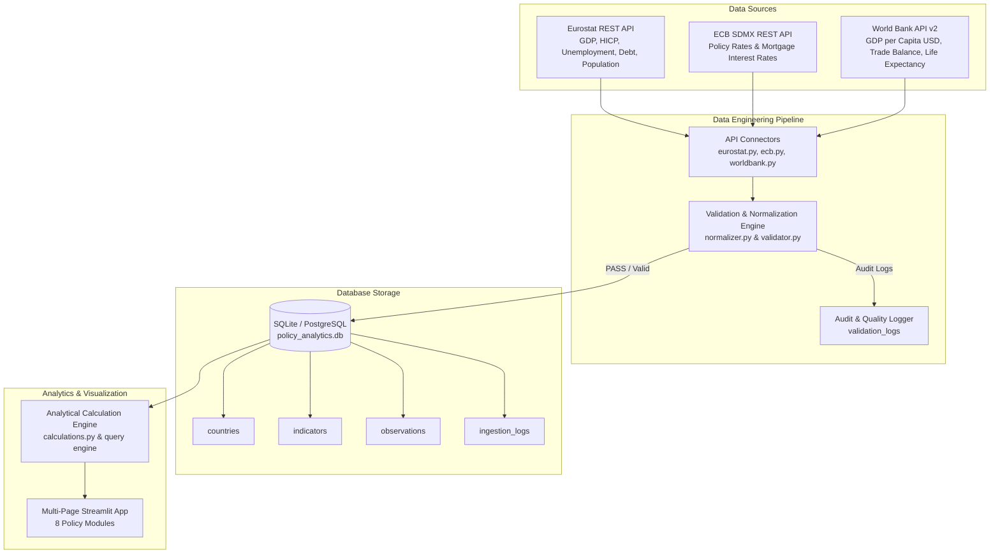

# 🇪🇺 European Policy Analytics

A production-grade, European-first **Data Engineering & Macroeconomic Analytics Platform** designed to ingest, validate, model, analyze, and visualize macroeconomic indicators, labor statistics, fiscal debt/deficit balances, energy & environmental metrics, monetary policy rates, and living standards across **31+ European economies**.

Built strictly with **REAL official APIs** from **Eurostat**, the **European Central Bank (ECB)**, and the **World Bank (API v2)**, the platform provides an interactive 8-page Streamlit analytical dashboard backed by an automated validation engine and relational database holding **12,541+ verified statistical observations**.

---

## 🚀 Live Demo & Repository
- 🔗 **Public Application URL:** [https://european-policy-analytics.streamlit.app](https://european-policy-analytics.streamlit.app)

---

## 🌟 Key Highlights & Engineering Features

- **🇪🇺 European-First Analytics**: Comprehensive cross-country comparison across all 27 EU member states, 4 EFTA/non-EU European economies (United Kingdom, Switzerland, Norway, Iceland), and key regional aggregates (`EU27`, `EA20`) categorized into official Eurostat regional groupings (*Western, Southern, Northern, Eastern, Central Europe*).
- **📡 Pure Official API Ingestion**: Direct integration with Eurostat REST API (`nama_10_gdp`, `nama_10_pc`, `prc_hicp_aind`, `une_rt_a`, `gov_10dd_edpt1`, `demo_gind`, `nrg_ind_ren`, `env_air_gge`, `ilc_peps01n`), ECB SDMX REST API (`FM/D.U2.EUR.4F.KR.MRR_RT.LEV`, `MIR/M.DE.B.A2C.A.R.A.2250.EUR.N`), and World Bank API v2 (`NY.GDP.PCAP.CD`, `NE.RSB.GNFS.ZS`, `SP.DYN.LE00.IN`). Zero hardcoded economic values or third-party placeholder datasets.
- **⭐ Relational Database Architecture**: Relational schema featuring `countries`, `indicators`, `observations`, `ingestion_logs`, and `validation_logs` enforcing unique constraints (`country_code`, `indicator_id`, `period`) and preserving full IEEE 754 float64 precision.
- **🛡️ Automated Data Quality Engine**: Rule-based validation storing audit status logs (`PASS`, `FAIL`, `WARNING`, `UNVERIFIED`) covering primary key integrity, deduplication, outlier detection, and time-weighted annual average calculations for monetary policy rates.
- **📊 8-Page Streamlit Dashboard**: Analytical policy dashboard offering macro overview, single-country explorer, side-by-side comparative engine, indicator inventory, European rankings, cross-indicator correlation/scatter engines with OLS trendlines, data quality portal, and methodology documentation.

---

## 🏗️ System Architecture



---

## 📊 Database Schema Architecture

```
               +------------------+
               |    countries     |
               +------------------+
               | code_iso3 (PK)   |
               | code_iso2        |
               | code_eurostat    |
               | name             |
               | region           |
               | is_eu            |
               +--------+---------+
                        |
                        | 1:N
               +--------v---------+
               |   observations   |
               +------------------+
               | id (PK)          |
               | country_code (FK)|
               | indicator_id (FK)|
               | period           |
               | value            |
               | unit             |
               | dataset_code     |
               | validation_note  |
               +--------+---------+
                        |
                        | N:1
               +--------v---------+
               |    indicators    |
               +------------------+
               | id (PK)          |
               | domain_id        |
               | name             |
               | short_name       |
               | unit             |
               | source_provider  |
               | dataset_code     |
               +------------------+
```

---

## 📡 Official Series Catalog Matrix

Every metric is fully traceable to its official source dataset and series key:

| Domain | Indicator ID | Official Dataset Code | Source Provider | Frequency | Unit |
|---|---|---|---|---|---|
| Economy | `GDP_REAL_GROWTH` | `nama_10_gdp` | Eurostat | Annual | % Change (CLV) |
| Purchasing Power | `GDP_PC_PPP` | `nama_10_pc` | Eurostat | Annual | PPS Index (EU27=100) |
| Economy | `HICP_INFLATION` | `prc_hicp_aind` | Eurostat | Annual | Annual % Rate |
| Labour & Income | `UNEMP_RATE` | `une_rt_a` | Eurostat | Annual | % of Labor Force |
| Labour & Income | `YOUTH_UNEMP_RATE` | `une_rt_a` | Eurostat | Annual | % of Youth Force |
| Public Finance | `GOV_DEBT_GDP` | `gov_10dd_edpt1` | Eurostat | Annual | % of GDP |
| Public Finance | `GOV_DEFICIT_GDP` | `gov_10dd_edpt1` | Eurostat | Annual | % of GDP |
| Demographics | `POPULATION` | `demo_gind` | Eurostat | Annual | Persons (1st Jan) |
| Energy & Env | `RENEWABLE_ENERGY_SHARE` | `nrg_ind_ren` | Eurostat | Annual | % of Consumption |
| Energy & Env | `GHG_EMISSIONS` | `env_air_gge` | Eurostat | Annual | k tonnes CO2eq |
| Demographics | `POVERTY_RISK_RATE` | `ilc_peps01n` | Eurostat | Annual | % of Population |
| Monetary Policy | `ECB_POLICY_RATE` | `FM/D.U2.EUR.4F.KR.MRR_RT.LEV` | ECB Data API | Daily (Time-Weighted) | % p.a. |
| Financial Mon | `HOUSEHOLD_LENDING_RATE` | `MIR/M.DE.B.A2C.A.R.A.2250.EUR.N` | ECB Data API | Monthly (Annual Avg) | % p.a. |
| Labour & Income | `AVG_ANNUAL_WAGE` | `NY.GDP.PCAP.CD` | World Bank API | Annual | Current USD ($) |
| Trade & Industry| `TRADE_BALANCE_GDP` | `NE.RSB.GNFS.ZS` | World Bank API | Annual | % of GDP |
| Demographics | `LIFE_EXPECTANCY` | `SP.DYN.LE00.IN` | World Bank API | Annual | Mean Years |

---

## 🖥️ Streamlit Dashboard Modules

The interactive Streamlit application contains **8 specialized page modules**:

1. **📊 Executive Overview**: European snapshot dashboard displaying headline macro metrics, cross-country trend lines, and interactive Plotly geographic maps.
2. **🏛️ European Country Explorer**: Deep-dive profile for any selected European country across all 8 policy domains with historical trend breakdowns vs. EU-27 averages.
3. **⚖️ Country Comparison**: Side-by-side comparative engine allowing users to select custom country groups, time horizons, and indicators with snapshot bar charts and CSV data exports.
4. **📖 Indicator Explorer & Catalog**: Searchable inventory of integrated indicators detailing dataset codes, provider sources, units, frequencies, and direct links to official data portals.
5. **🏆 European Rankings**: Ranks European economies by indicator performance for any chosen year, respecting directionality (e.g. low unemployment is top performance) and disclosing missing observations.
6. **🔬 Trends & Indicator Relationships**: Cross-indicator scatter plot engine with OLS linear trendlines, Pearson correlation coefficients ($r$), $R^2$, $p$-values, and correlation disclaimers.
7. **🛡️ Data Quality & Official Sources Portal**: Complete data provenance dashboard showing database health, validation logs, data freshness, and interactive live API re-ingestion triggers.
8. **📐 Methodology & Analytical Standards**: Transparent guide documenting percentage vs. percentage-point change formulas, CAGR calculations, ISO country normalization, and derived EU aggregate rules.

---

## 🚀 Quickstart & Reproducibility

### Local Setup

```bash
# 1. Clone workspace
git clone https://github.com/tsakirisand/European-Policy-Analytics.git
cd European-Policy-Analytics

# 2. Install dependencies
pip install -r requirements.txt

# 3. Run live data ingestion pipeline (Retrieves Eurostat, ECB, World Bank APIs)
python3 -c "from src.pipeline.ingestion import run_ingestion_pipeline; run_ingestion_pipeline()"

# 4. Launch Streamlit Dashboard
streamlit run app.py
```

---

## 🧪 Automated Testing

Run the automated pytest test suite covering API parsing, normalizer rules, validator bounds, ECB time-weighted duration calculations, precision preservation, and source attribution:

```bash
PYTHONPATH=. python3 -m pytest -v
```

Output:
```text
============================= test session starts ==============================
platform darwin -- Python 3.14.6, pytest-9.1.1, pluggy-1.6.0
rootdir: /Users/andreastsakiris/European-Policy-Analytics
configfile: pytest.ini
collected 32 items

tests/test_calculations.py::test_percentage_change PASSED                [  3%]
tests/test_calculations.py::test_percentage_point_change PASSED          [  6%]
tests/test_calculations.py::test_cagr PASSED                             [  9%]
tests/test_calculations.py::test_series_summary PASSED                   [ 12%]
tests/test_connectors.py::test_eurostat_json_stat_parsing PASSED         [ 15%]
tests/test_connectors.py::test_world_bank_parsing PASSED                 [ 18%]
tests/test_connectors.py::test_world_bank_multi_page_pagination PASSED   [ 21%]
tests/test_connectors.py::test_world_bank_european_country_coverage PASSED [ 25%]
tests/test_normalizer.py::test_country_code_normalization PASSED         [ 28%]
tests/test_normalizer.py::test_country_names PASSED                      [ 31%]
tests/test_normalizer.py::test_eu27_list PASSED                          [ 34%]
tests/test_normalizer.py::test_normalize_observation PASSED              [ 37%]
tests/test_normalizer.py::test_deduplication PASSED                      [ 40%]
tests/test_phase2_verification.py::test_production_ecb_time_weighted_policy_rate_calculation PASSED [ 43%]
tests/test_phase2_verification.py::test_production_ecb_incomplete_current_year_warning PASSED [ 46%]
tests/test_phase2_verification.py::test_production_analytics_precision_and_presentation PASSED [ 50%]
tests/test_phase2_verification.py::test_production_ingestion_and_save_observations PASSED [ 53%]
tests/test_phase2_verification.py::test_production_normalizer_and_validator PASSED [ 56%]
tests/test_phase2_verification.py::test_audit_category_reconciliation PASSED [ 59%]
tests/test_phase3_verification.py::test_production_source_matches_metadata PASSED [ 62%]
tests/test_phase3_verification.py::test_source_attribution_matches_stored_observation PASSED [ 65%]
tests/test_phase3_verification.py::test_hicp_and_cpi_not_interchangeable PASSED [ 68%]
tests/test_phase3_verification.py::test_population_reference_period_documentation PASSED [ 71%]
tests/test_phase3_verification.py::test_annual_average_and_yearend_interest_rates_distinct PASSED [ 75%]
tests/test_phase3_verification.py::test_historical_revisions_require_evidence PASSED [ 78%]
tests/test_phase3_verification.py::test_unverified_observations_not_labeled_verified PASSED [ 81%]
tests/test_pipeline.py::test_seed_metadata PASSED                        [ 84%]
tests/test_pipeline.py::test_save_observations PASSED                    [ 87%]
tests/test_validator.py::test_valid_observation PASSED                   [ 90%]
tests/test_validator.py::test_invalid_period PASSED                      [ 93%]
tests/test_validator.py::test_outlier_sanity_check PASSED                [ 96%]
tests/test_validator.py::test_null_value PASSED                          [100%]

============================== 32 passed in 1.50s ==============================
```

---

## 📁 Repository Structure

```
European-Policy-Analytics/
├── config.py                  # Database paths, API endpoints, and global settings
├── app.py                     # Streamlit application entrypoint & navigation
├── data/
│   └── policy_analytics.db    # SQLite relational database (12,541+ observations)
├── src/
│   ├── analytics/
│   │   └── calculations.py    # Analytical metrics (Pct Change, Pct-Point, CAGR, Summary)
│   ├── connectors/
│   │   ├── base.py            # Abstract Base API connector with session retries
│   │   ├── eurostat.py        # Eurostat REST API & JSON-stat parser
│   │   ├── ecb.py             # ECB SDMX REST API & time-weighted policy rate calculator
│   │   └── worldbank.py       # World Bank API v2 client with multi-page pagination
│   ├── metadata/
│   │   ├── countries.py       # European country registry & ISO normalization
│   │   ├── domains.py         # Policy domain definitions
│   │   └── indicators.py      # Indicator catalog, series keys, and units
│   ├── models/
│   │   └── database.py        # SQLAlchemy models & database initializer
│   ├── pipeline/
│   │   ├── ingestion.py       # Live API ingestion pipeline orchestrator
│   │   ├── normalizer.py      # ISO normalization & record deduplication
│   │   └── validator.py       # Data validation & quality rule checker
│   └── ui/
│       ├── components/        # Reusable Streamlit UI components & charts
│       └── pages/             # 8 Dedicated analytical dashboard page modules
├── tests/                     # 32 Comprehensive automated pytest unit tests
├── FINAL_PRE_RELEASE_AUDIT.md # Complete audit documentation & empirical evidence
├── requirements.txt           # Python dependencies
├── pytest.ini                 # Pytest configuration
└── README.md                  # System documentation & quickstart guide
```

---

## 📜 License & Data Attribution

Data provided by:
- **Eurostat** under the [Eurostat Reuse Policy](https://ec.europa.eu/eurostat/about-us/policies/copyright).
- **European Central Bank (ECB)** under the [ECB Open Data License](https://www.ecb.europa.eu/services/terms/html/index.en.html).
- **World Bank** under the [World Bank Open Data License](https://www.worldbank.org/en/about/legal/terms-of-use-for-datasets).
